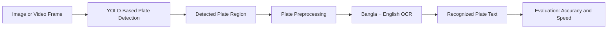

# Real-Time Bangladeshi License Plate Detection & Recognition

### A Deep Learning–Based Framework for Bangladeshi Traffic Scenarios

  
  
  
  

**Course:** CSE 498R — Research  
**Faculty:** Dr. Md Mansur ul Mulk (MSLK)  
**Semester:** Fall 2026

---

## 📌 Project Overview

This research explores a practical **License Plate Detection and Recognition (LPR)** framework tailored to Bangladeshi traffic. The proposed system combines a **YOLO-based object detector** with a specialized **Optical Character Recognition (OCR)** module to locate license plates and recognize Bangla and English characters, including numerical sequences.

The goal is to balance recognition reliability and detection accuracy with robustness in challenging conditions and the speed needed for real-time use. Potential application areas include intelligent transportation systems, vehicle identification, traffic monitoring, and automated parking management.

> **Research status:** Initial research planning and conceptual pipeline design. Model implementation and experimental evaluation are planned next steps; benchmark results are not yet reported.

## 🎯 Research Objectives

- **Detect license plates:** Investigate YOLO-based detection for localizing plates in images and video streams.
- **Recognize Bangladeshi plate text:** Explore an OCR pipeline suited to Bangla and English characters and digits.
- **Improve real-world robustness:** Study performance under low light, nighttime scenes, rain, fog, excessive brightness, and motion blur.
- **Support diverse vehicles:** Consider private cars, commercial vehicles, motorcycles, and government vehicles.
- **Enable real-time deployment:** Evaluate inference latency and frames per second (FPS), including the potential use of model quantization for resource-constrained devices.

## 🧠 Proposed System Pipeline

*This diagram represents the proposed workflow, not a claim that all modules have been implemented.*

## 🔬 Research Scope

### Detection and recognition

The framework is intended to connect plate localization with character-level text recognition. A key research challenge is handling the layouts and mixed character patterns found on Bangladeshi license plates rather than relying only on generic OCR approaches.

### Robustness in real-world conditions

The planned evaluation will consider image-quality challenges such as:

- Low illumination and nighttime scenes
- Rain, fog, and other adverse weather
- Excessive brightness and motion blur
- Differences in plate formats and vehicle categories

### Efficiency and deployment

Alongside detection and recognition quality, the research will investigate computational efficiency. Model quantization is a potential optimization strategy for reducing deployment cost on resource-constrained hardware.

## 📊 Evaluation Plan

The report identifies the following metrics for upcoming experiments:

| Evaluation area | Planned metrics |
|---|---|
| Detection | Precision, recall, and mean Average Precision (mAP) |
| Text recognition | Character recognition accuracy |
| Real-time performance | Inference latency and frames per second (FPS) |
| Robustness | Performance across vehicle types and challenging lighting/weather conditions |

No numerical results are included at this stage because baseline experiments have not yet been reported.

## 👥 Research Team

| Student ID | Team member | University email |
|---|---|---|
| 2211461642 | Md. Yousuf | [md.yousuf01@northsouth.edu](mailto:md.yousuf01@northsouth.edu) |
| 2211950642 | MD. Rokib Hasan Oli | [rokib.oli@northsouth.edu](mailto:rokib.oli@northsouth.edu) |
| 2131228042 | Tashfia Adiba Zaman Nizhum | [tashfia.nizum@northsouth.edu](mailto:tashfia.nizum@northsouth.edu) |
| 2212346042 | Md Rakibul Hasan | [rakibul.hasan30@northsouth.edu](mailto:rakibul.hasan30@northsouth.edu) |

## 🎓 Academic Information

- **Course:** CSE 498R Research
- **Semester:** Fall 2026
- **Faculty:** Dr. Md Mansur ul Mulk (MSLK)
- **Institution:** North South University

---

*Research project in progress · Fall 2026*

