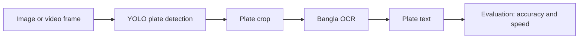

<div align="center">

# Real-Time Bangladeshi License Plate Detection & Recognition

### A Deep Learning–Based Framework for Bangladeshi Traffic Scenarios

<p>
  
  
  
  
  
</p>

**Course:** CSE 498R — Research  
**Faculty:** Dr. Md Mansur ul Mulk (MSLK)  
**Semester:** Fall 2026 · North South University

</div>

---

## 📌 Project overview

This research builds a practical **License Plate Detection and Recognition (LPR)** system for Bangladeshi traffic:
a **YOLO-based detector** finds the plate, and an **OCR module** reads the Bangla text (district, "মেট্রো", letter
and digits).

**Current phase (October 2026): re-implementing 20 related papers.** Each member re-runs five published methods on
our shared dataset, the **498R BanglaLPR All-in-One** (10,623 detection photos and 7,024 plate crops from 15 public
sources; see [data/](data/README.md)), on Kaggle (2× Tesla T4), and compares the result with what the paper reports.
The best ideas feed our own pipeline.



## 🗂️ Repository map

```text
CSE498R/
├── README.md            ← you are here: project, paper tracker, where things are
├── CONTRIBUTING.md      ← how to add your results (which file goes where, how to upload)
├── data/                ← dataset card: sources, licences, statistics, sample images
├── weights/             ← ONE FOLDER PER PAPER AND MEMBER: weights/paperNN/<Member>/
│                          README (start here), results_vs_paper.md, paperNN_results.zip, best*.pt, study report PDF
├── notebooks/<Member>/  ← finished Kaggle notebooks: paperNN_run.ipynb (+ .log)
├── src/<Member>/        ← code to run a paper again: paperNN/START_HERE.md, paperNN/kaggle/paperNN_kaggle.ipynb
├── report/<Member>/     ← written reports, reading notes, report sources
├── results/             ← team results table (ours vs. the papers, all members)
├── output/              ← full Kaggle output zips (Git LFS, 40–250 MB each)
└── requirements.txt     ← packages to load the models locally
```

**To look at one paper's results, open `weights/paperNN/<Member>/README.md`.** It links to everything else.

## 📄 Paper tracker

Status: ✅ done on dataset v1.1 · ☑️ done on v1.0 and still valid · 🔁 uploaded, re-run on v1.1 needed ·
🟡 partly uploaded · ⬜ not uploaded yet

### MD. Rokib Hasan Oli — `MD.Rokib.Hasan.Oli`

| # | Paper | Status | Main result (our data) | Files |
|---|---|---|---|---|
| 2 | Cascaded YOLO-based approach for Bangladeshi license plate identification and number recognition | ✅ | Character-YOLO reader: **87.71 %** of 651 plates exact; full pipeline 86.76 %; at night 66.7 % vs 38.3 % for the authors' weights | [results](weights/paper02/MD.Rokib.Hasan.Oli/) · [notebook](notebooks/MD.Rokib.Hasan.Oli/paper02_run.ipynb) · [kit](src/MD.Rokib.Hasan.Oli/paper02/) · [notes](report/MD.Rokib.Hasan.Oli/paper02/) |
| 6 | YOLOv8-Based License Plate Recognition for Bangladeshi Vehicles | ✅ | YOLOv8n/s mAP50 **97.39 / 97.61 %**; the paper's stock EasyOCR reads only 13.52 % of plates exactly | [results](weights/paper06/MD.Rokib.Hasan.Oli/) · [notebook](notebooks/MD.Rokib.Hasan.Oli/paper06_run.ipynb) · [kit](src/MD.Rokib.Hasan.Oli/paper06/) · [notes](report/MD.Rokib.Hasan.Oli/paper06/) |
| 8 | Bengali License Plate Recognition: Unveiling Clarity with CNN and GFP-GAN | ✅ | Symbol CNN **93.08 %**, but the paper's full plate reader gets 0.15 % of plates exact (its contour step finds 52 % of symbols) | [results](weights/paper08/MD.Rokib.Hasan.Oli/) · [notebook](notebooks/MD.Rokib.Hasan.Oli/paper08_run.ipynb) · [kit](src/MD.Rokib.Hasan.Oli/paper08/) · [notes](report/MD.Rokib.Hasan.Oli/paper08/) |
| 23 | Do We Train on Test Data? The Impact of Near-Duplicates on License Plate Recognition | ✅ | KUET's leaky split inflates plate reading from **77.84 % to 85.57 %** on the same 194 plates (p = 0.008) | [results](weights/paper23/MD.Rokib.Hasan.Oli/) · [notebook](notebooks/MD.Rokib.Hasan.Oli/paper23_run.ipynb) · [kit](src/MD.Rokib.Hasan.Oli/paper23/) · [notes](report/MD.Rokib.Hasan.Oli/paper23/) |
| 24 | Leveraging Model Fusion for Improved License Plate Recognition | ✅ | Format fallback (char-YOLO, then CRNN): **88.63 %** exact, +1.84 over the best single model (12 fixed, 0 broken) | [results](weights/paper24/MD.Rokib.Hasan.Oli/) · [notebook](notebooks/MD.Rokib.Hasan.Oli/paper24_run.ipynb) · [kit](src/MD.Rokib.Hasan.Oli/paper24/) · [notes](report/MD.Rokib.Hasan.Oli/paper24/) |

### Md. Yousuf — `Md.Yousuf`

| # | Paper | Status | Main result (our data) | Files |
|---|---|---|---|---|
| 3 | A Cloud-Based Hybrid Model for Real-Time Detection of BRTA-Approved Licence Plates Using YOLO Tiny and Haar Cascade | ☑️ | YOLOv8n plate detector mAP50 **98.80 %** (416 px); the paper's Haar-cascade design F1 4.19 % | [results](weights/paper03/Md.Yousuf/) · [notebook](notebooks/Md.Yousuf/paper03_run.ipynb) · [report](report/Md.Yousuf/Paper03_Report.md) |
| 20 | Toward Advancing License Plate Super-Resolution in Real-World Scenarios: A Dataset and Benchmark | 🔁 | CRNN reader 74.04 % exact; ×2 super-resolution 24.12 % vs bicubic 23.81 % on low-res plates | [results](weights/paper20/Md.Yousuf/) · [notebook](notebooks/Md.Yousuf/paper20_run.ipynb) · [report](report/Md.Yousuf/Paper20_Report.md) |
| 26 | YOLOv12: Attention-Centric Real-Time Object Detectors | ⬜ | – | – |
| 27 | YOLOv10: Real-Time End-to-End Object Detection | 🔁 (character models only) | YOLOv10-N and YOLOv8-N plate mAP50 **98.7 %**; character reader v8n 84.02 % vs v10n 81.57 % | [results](weights/paper27/Md.Yousuf/) · [notebook](notebooks/Md.Yousuf/paper27_run.ipynb) · [report](report/Md.Yousuf/Paper27_Report.md) |
| 28 | YOLOv9: Learning What You Want to Learn Using Programmable Gradient Information | ☑️ | YOLOv9-S best mAP50 **98.79 %**; YOLOv8-N fastest (6.38 ms TensorRT FP16) | [results](weights/paper28/Md.Yousuf/) · [notebook](notebooks/Md.Yousuf/paper28_run.ipynb) · [report](report/Md.Yousuf/Paper28_Report.md) |

### Md Rakibul Hasan — `Md.Rakibul.Hasan`

| # | Paper | Status | Main result (our data) | Files |
|---|---|---|---|---|
| 11 | Real-time Bangla License Plate Recognition System for Low Resource Video-based Applications | 🟡 notebook + outputs zip; `weights/paper11/Md.Rakibul.Hasan/` still missing | see the notebook | [notebook](notebooks/Md.Rakibul.Hasan/paper11_run.ipynb) · [outputs zip](output/paper11_outputs.zip) |
| 17 | Advancing Multinational License Plate Recognition Through Synthetic and Real Data Fusion | ⬜ | – | – |
| 18 | An Embedded Real-Time License Plate Recognition System for Complex Traffic Scenes | ⬜ | – | – |
| 21 | Advanced deep learning techniques for automated license plate recognition | ⬜ | – | – |
| 30 | DETRs Beat YOLOs on Real-time Object Detection (RT-DETR) | ⬜ | – | – |

### Tashfia Adiba Zaman Nizhum — `Tashfia.Adiba.Zaman.Nizhum`

| # | Paper | Status | Main result (our data) | Files |
|---|---|---|---|---|
| 1 | A Robust Deep Learning Framework for Bangla License Plate Recognition Using YOLO and Vision-Language OCR | ⬜ | Precision: **95.80%**; Recall: **94.67%**; mAP@50: **96.50%**; mAP@50-95: **44.46%**|
| 10 | BLPnet: A new DNN model and Bengali OCR engine for Automatic License Plate Recognition | ⬜ | – | – |
| 22 | Advancing Vehicle Plate Recognition: Multitasking Visual Language Models with VehiclePaliGemma | ⬜ | – | – |
| 31 | Scene Text Recognition with Permuted Autoregressive Sequence Models (PARSeq) | ⬜ | – | – |
| 32 | Optical Text Recognition in Nepali and Bengali: A Transformer-based Approach | ⬜ | – | – |

All numbers side by side: [results/results_table.md](results/results_table.md). Numbers from different dataset
versions or different test sets are not directly comparable.

## ⬆️ How to add your results (short version)

1. Finish the Kaggle run (`FAST = False`) and download the notebook and `paperNN_outputs.zip`.
2. Notebook → `notebooks/<Member>/paperNN_run.ipynb`.
3. README, `results_vs_paper.md`, `paperNN_results.zip`, `best*.pt` (< 25 MB each on the web) → `weights/paperNN/<Member>/`.
4. The full `paperNN_outputs.zip` → team Drive `498R / weights / paperNN /`.
5. Update your row in the paper tracker above.

Full guide, with a README template and the upload steps: **[CONTRIBUTING.md](CONTRIBUTING.md)**.

## 📦 Where the big files are

| What | Where |
|---|---|
| Dataset v1.1 (zip) | Team Drive folder [All In One 1.1](https://drive.google.com/drive/folders/11psdzW5Cpr7tXwqzqNxNt3LA-qeDSOQl), or the Kaggle dataset `498r-bangla-lpr-all-in-one`. The notebooks download it by themselves |
| Full run outputs (`paperNN_outputs.zip`, every `last.pt`) | Team Drive `498R / weights / paperNN /`; some are also in [output/](output/README.md) (Git LFS) |
| Models over 100 MB | Team Drive |

## 🧪 Using a trained model

```bash
pip install -r requirements.txt      # install PyTorch first from pytorch.org
```

Each `weights/paperNN/<Member>/README.md` has a **Quick start** with the exact code for its models. The Bangla
plate decoder (`vocab.py`) is inside each `paperNN_results.zip` (`code/`) and in `src/<Member>/paperNN/kaggle/`.

## 👥 Research team

| Student ID | Team member | University email | Papers |
|---|---|---|---|
| 2211461642 | Md. Yousuf | [md.yousuf01@northsouth.edu](mailto:md.yousuf01@northsouth.edu) | 3, 20, 26, 27, 28 |
| 2211950642 | MD. Rokib Hasan Oli | [rokib.oli@northsouth.edu](mailto:rokib.oli@northsouth.edu) | 2, 6, 8, 23, 24 |
| 2131228042 | Tashfia Adiba Zaman Nizhum | [tashfia.nizum@northsouth.edu](mailto:tashfia.nizum@northsouth.edu) | 1, 10, 22, 31, 32 |
| 2212346042 | Md Rakibul Hasan | [rakibul.hasan30@northsouth.edu](mailto:rakibul.hasan30@northsouth.edu) | 11, 17, 18, 21, 30 |

## 🎯 Research objectives

- **Detect plates** with YOLO-family detectors in photos and video.
- **Read Bangladeshi plate text** (Bangla district names, letters and digits) reliably.
- **Stay robust** at night and in rain, fog, glare and motion blur, for all vehicle types.
- **Run in real time**: measure latency and FPS, including quantised (TensorRT FP16) models.

| Evaluation area | Metrics |
|---|---|
| Detection | Precision, recall, mAP50, mAP50-95, plates found |
| Text recognition | Whole-plate exact match, character accuracy, CER |
| Speed | ms per image, FPS (PyTorch FP32, TensorRT FP16, CPU) |
| Robustness | Results per condition (night, blur, small plates, weather) and per vehicle type |

## 🎓 Academic information

- **Course:** CSE 498R Research
- **Semester:** Fall 2026
- **Faculty:** Dr. Md Mansur ul Mulk (MSLK)
- **Institution:** North South University

---

<div align="center">

*Research project in progress · Fall 2026*

</div>
