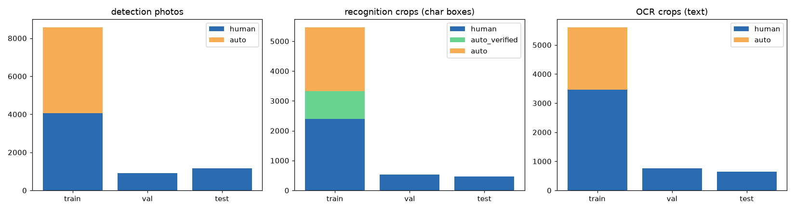
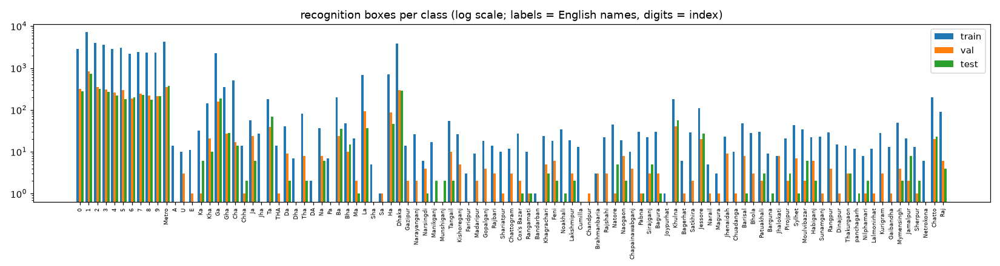
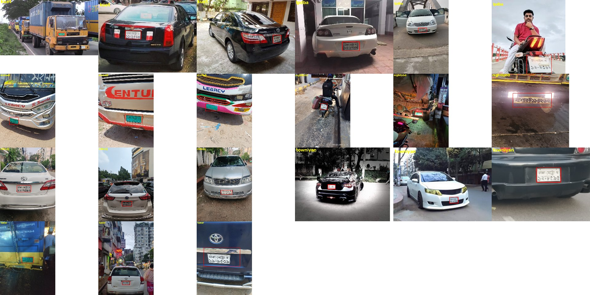
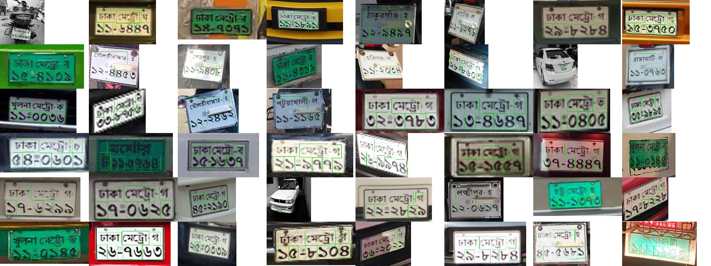

# Bangla License Plate Datasets Collection

A curated collection of benchmark datasets for Bangla Automatic License Plate Recognition (ALPR), vehicle detection, and character recognition under diverse environmental conditions.

---

## Sources and licences
| source | dataset | licence |
|---|---|---|
| anpr | Bangladesh ANPR Dataset (Kaggle mahedifindsdataset) | CC BY 4.0 |
| bdalpdr | BD-ALPDR (Nooruddin et al.) - team Drive | CC BY-NC-SA 4.0 |
| blpd | BLPD (Sarker & Alam, PLOS One 2026; Kaggle ferozahmedds / GitHub prosensarker4/BLPD) | Apache-2.0 (Kaggle copy) |
| blpd_ext | BLPD external validation photos (Sarker & Alam 2026) | Apache-2.0 (Kaggle copy) |
| diu | Vehicle License Plate Detection Dataset (DIU, Mendeley nntnnzffw4) - team Drive | CC BY 4.0 |
| foggy_bd | Foggy License Plates Worldwide, Bangladesh part (Mendeley rgpddwxrx5) - team Drive | CC BY 4.0 |
| kuet | Bangladeshi License Plate Recognition Dataset (Hossain & Hassan, KUET; Kaggle syednahinhossain) | Apache-2.0 |
| lpd4k | Roboflow lpd4k (Kaggle tarakuzzamanfaysal bangla-license-plate-yolov9) | CC BY 4.0 |
| lpdba | Bangla LPDB-A (Shomee & Sams, DICTA 2021; YOLO copy Kaggle arstrxshad) | CC BY 4.0 |
| mahedi | Bangladesh Vehicle Number Plate Detection Dataset (Kaggle mahedifindsdataset) | CC BY 4.0 |
| nightlpbd | NightLPBD (Hasan & Ahsan, IEEE COMPAS 2025; Kaggle thasan3003) | CC BY 4.0 |
| ridoykj | Bangladeshi Vehicle Number Plates (Kaggle ridoykj) | CC BY-NC-SA 4.0 |
| towniyan | Bangladeshi Cars with Number Plates Visible (Kaggle towniyan) | CC0 1.0 |
| tusar | Bangla License Plate (Tusar et al., IICAIET 2022; Kaggle mahmudolhasantushar) | CC BY-NC-SA 4.0 |
| zenodo25k | Bangla License Plate Dataset 2.5k (Zenodo 7110401) - team Drive | CC BY 4.0 |

Respect each source's licence (several are **non-commercial**, CC BY-NC-SA). Cite the original datasets when you publish.
Our build scripts are in the team repo (`_dataset_build/scripts`).
## ⚖️ Usage & Licensing Notice

# Statistics

## Detection photos per source
| source | train | val | test | total |
|---|---|---|---|---|
| bdalpdr | 54 | 0 | 0 | 54 |
| blpd | 549 | 0 | 0 | 549 |
| diu | 2265 | 0 | 0 | 2265 |
| kuet | 1758 | 311 | 540 | 2609 |
| lpd4k | 1573 | 0 | 0 | 1573 |
| lpdba | 1132 | 330 | 205 | 1667 |
| mahedi | 223 | 34 | 32 | 289 |
| nightlpbd | 92 | 52 | 60 | 204 |
| ridoykj | 698 | 101 | 274 | 1073 |
| towniyan | 65 | 14 | 13 | 92 |
| tusar | 165 | 54 | 29 | 248 |
| **total** | 8574 | 896 | 1153 | 10623 |

## Plates per split, by size (as a 640-px detector sees them)
| split | photos | no-plate photos | plates | small (<32²) | medium | large (>96²) | dark photos (mean grey < 60) |
|---|---|---|---|---|---|---|---|
| train | 8574 | 466 (5.4 %) | 8651 | 1001 | 5138 | 2512 | 210 |
| val | 896 | 99 (11.0 %) | 850 | 110 | 495 | 245 | 35 |
| test | 1153 | 160 (13.9 %) | 1011 | 30 | 795 | 186 | 20 |

## Recognition crops per source
| source | train | val | test | total |
|---|---|---|---|---|
| anpr | 930 | 0 | 0 | 930 |
| blpd | 130 | 25 | 30 | 185 |
| kuet | 908 | 200 | 183 | 1291 |
| lpdba | 1291 | 280 | 202 | 1773 |
| nightlpbd | 70 | 31 | 52 | 153 |
| zenodo25k | 2136 | 0 | 0 | 2136 |
| **total** | 5465 | 536 | 467 | 6468 |

## Recognition boxes by token kind
| kind | train | val | test |
|---|---|---|---|
| digit | 32790 | 3216 | 2802 |
| letter | 5465 | 536 | 467 |
| district | 5465 | 536 | 467 |
| metro | 4272 | 355 | 371 |

101 classes are used. Rarest classes in test: অ (0), উ (0), এ (0), ঝ (0), ঠ (0), ঢ (0), দ (0), প (0), শ (0), স (0), গাজীপুর (0), নারায়ণগঞ্জ (0)

## OCR crops (plate text) per source
| source | train | val | test | total |
|---|---|---|---|---|
| anpr | 1072 | 230 | 184 | 1486 |
| blpd | 130 | 25 | 30 | 185 |
| kuet | 908 | 200 | 183 | 1291 |
| lpdba | 1291 | 280 | 202 | 1773 |
| nightlpbd | 70 | 31 | 52 | 153 |
| zenodo25k | 2136 | 0 | 0 | 2136 |
| **total** | 5607 | 766 | 651 | 7024 |

| split | plates | with মেট্রো | districts seen |
|---|---|---|---|
| train | 5607 | 4363 | 64 |
| val | 766 | 480 | 58 |
| test | 651 | 492 | 37 |

## End-to-end test photos: 204 (blpd_ext: 144, nightlpbd: 60)

## Samples

* Ensure compliance with the respective licenses when using these datasets for research or production:
  * **CC BY 4.0:** Requires attribution to the original dataset authors.
  * **CC BY-NC-SA 4.0:** Restricted to non-commercial use with reciprocal licensing terms.
